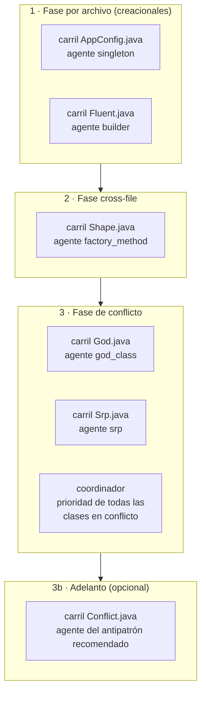
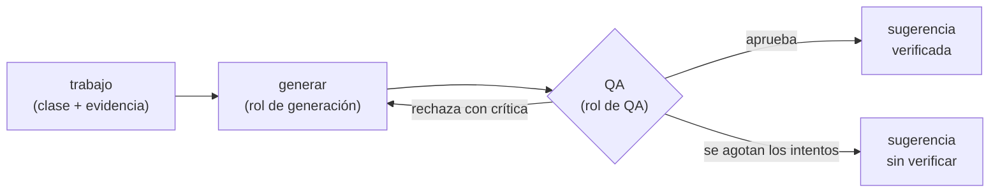

# Arquitectura multiagente

El backend genera las sugerencias de refactor con **un agente por antipatrón**. Los agentes de un mismo batch corren **en paralelo**, con un tope de concurrencia y de tiempo. Esta página explica cómo se arma ese grafo, qué contrato cumple un agente, cómo se agrega uno nuevo y cómo leer por qué un batch tardó lo que tardó.

## Por qué un orquestador propio

Antes de construirlo se compararon tres opciones con un prototipo: un orquestador propio sobre `ThreadPoolExecutor`, LangGraph, y frameworks de agentes conversacionales (CrewAI, AutoGen). El prototipo usaba IA falsa, con 0,5 s por llamada, y 27 sugerencias de God Class y DIP sobre Gson, cada una con su revisión del QA.

| Flujo | Tiempo con tope 4 |
|---|---:|
| Secuencial (sin agentes en paralelo) | 29,1 s |
| **Orquestador propio** | **7,7 s** |
| LangGraph | 9,8–10,5 s |

- **Ganó el orquestador propio:** fue el más rápido, no suma dependencias y no toca el dominio.
- **LangGraph agregaba costo sin uso:** unos 80 ms por tarea, 28 MB de dependencias y cerca de 1 s de import en cada arranque en frío de Render. Lo que trae de más (estado persistente, ramas por resultados intermedios) este flujo no lo usa.
- **CrewAI y AutoGen resuelven otro problema:** agentes que conversan entre sí. Además, CrewAI pesa 795 MB.

La decisión completa, con todas las mediciones, está en el ADR del backend (`docs/adr/0001-arquitectura-multiagente.md`).

## El grafo de un batch

Un batch pasa por **tres fases**, siempre en el mismo orden. Cada fase espera a que termine la anterior, porque la respuesta se arma en orden y la última depende de lo que encontraron las primeras.

- **Carril:** dentro de una fase, los trabajos se agrupan en carriles, uno por archivo. En un carril los trabajos van en orden.
- **Paralelismo:** los carriles corren en paralelo, hasta `AGENT_MAX_CONCURRENCY` a la vez.

**Las fases:**

1. **Fase por archivo.** Sale de los detectores Singleton y Builder.
   - Si la clase es candidata y todavía no implementa el patrón, su agente genera la sugerencia.
   - Si la clase además tiene God Class o SRP, la sugerencia se **pospone**: primero hay que resolver lo estructural.
2. **Fase cross-file.** Es Factory Method, que necesita ver todo el batch (la interfaz y sus implementaciones) antes de decidir.
3. **Fase de conflicto.**
   - **Clase sin conflicto:** su God Class o SRP genera la sugerencia en el batch.
   - **Clase con dos o más antipatrones:** no se genera nada. El **coordinador** le pide a la IA qué antipatrón resolver primero, para todas esas clases **en una sola llamada** (de a `PRIORITY_BATCH_SIZE`), al lado de los carriles de generación.
   - **Respaldo:** si esa respuesta conjunta no se puede leer, el coordinador pregunta clase por clase.
4. **Adelanto (opcional).** Con `CONFLICT_PREFETCH_RECOMMENDED=true`, después de la prioridad corre el agente del antipatrón recomendado de cada clase en conflicto. Su sugerencia queda lista en la advertencia, para cuando el usuario elija.

### Qué hace un agente por dentro

Cada agente envuelve al **generador** de su antipatrón; no lo reescribe:

- **Si la IA falla** (timeout, respuesta inválida, cuota agotada): el agente devuelve **sin sugerencia** (`suggestion: null`) y el resto del batch sigue.
- **Tokens:** cada agente mide los tokens de su trabajo, y también suman al total del batch (`tokenUsage`).

## El contrato de un agente

| Pieza | Qué es |
|---|---|
| **Entrada: trabajo** | El antipatrón y el contexto de la clase: el archivo, el nombre de la clase, su código, el hallazgo con su evidencia y, en el conflicto, los otros antipatrones, que el QA ignora. |
| **Salida: resultado** | La sugerencia ya revisada por el QA (o `null`) y los tokens que gastó ese trabajo. |
| **Error** | Un fallo de la IA **no** es un error: es `null`. Una excepción es un error de programación (por ejemplo, faltan los puertos de IA) y la maneja la fase que pidió el trabajo. |

El código vive en `app/application/agents/` del backend. El documento de referencia del contrato, con los nombres de las clases y los invariantes que fijan los tests, es `docs/contrato-agentes.md` en el repositorio del backend.

## Agregar un agente

Un agente nuevo **es un generador nuevo**; el orquestador no se toca. De punta a punta:

1. **Detector.** Si el antipatrón todavía no se detecta, crear su paquete en `app/domain/detectors/<nombre>_detector/` con la regla, la evidencia y el adaptador registrado con `@register_detector("clave")`.
2. **Generador.** En `app/domain/refactor/`, crear una subclase de `RefactorGenerator`, o de `SnippetGenerator` si la sugerencia es un fragmento de código, con `@register_generator("clave")`. Implementa tres pasos:
   - `compute_evidence`: qué justifica generar;
   - `build_context`: qué se le manda al modelo;
   - `parse_suggestion`: cómo se lee la respuesta.
3. **¿Genera en el batch?** Por defecto, el agente corre solo cuando el usuario lo elige (`POST /analyze/refactor-choice`). Para que genere en el batch:
   - en un antipatrón estructural o SOLID, marcar `generates_in_batch = True` en su detector; el agente corre en la fase de conflicto si la clase no está en conflicto;
   - en un patrón creacional, heredar de `CreationalGenerator`; el agente corre en la fase por archivo.
4. **Listo.** El catálogo de agentes se arma desde el registro de generadores, así que el agente ya existe y lo usan el batch y el endpoint de elección.
5. **Probarlo.** Los tests pueden inyectar un agente falso en el pipeline; el ejemplo está en `tests/test_agent_contract.py` del backend. Para probar el generador real sin red, se usa un modelo falso.

## Configuración

Todo va en el `.env` del backend. En la columna "Default", 0 en los topes de tiempo significa sin tope.

| Variable | Default | Qué controla |
|---|---:|---|
| `AGENT_MAX_CONCURRENCY` | `4` | Carriles (y llamadas a la IA) a la vez en cada fase. `1` = secuencial. Antes se llamaba `AI_MAX_CONCURRENCY`, y ese nombre se sigue aceptando. Si tu cuota devuelve 429 seguido, bajalo. |
| `AGENT_TIMEOUT_SECONDS` | `120` | Tope de un agente: generar, revisar y regenerar. Si lo pasa, sale sin sugerencia y el resto sigue. |
| `BATCH_AGENTS_DEADLINE_SECONDS` | `240` | Tope del conjunto de agentes del batch. Al vencer, lo que no empezó no corre y la respuesta sale con lo listo. Queda por debajo de los 300 s que espera la extensión. |
| `CONFLICT_PREFETCH_RECOMMENDED` | `false` | Adelanta la sugerencia del antipatrón recomendado en cada clase en conflicto. Hoy solo para God Class y SRP, que tienen lugar para la sugerencia en la respuesta. Cuesta una generación y su revisión por clase, se elija o no. |
| `PRIORITY_BATCH_SIZE` | `10` | Clases en conflicto por llamada de prioridad. |
| `CREATIONAL_SUGGESTIONS_IN_BATCH` | `true` | Si los creacionales generan en el batch o solo a demanda. |

**Cómo se respeta el tope de tiempo:** cada llamada a la IA recorta su propio timeout a lo que le queda al agente y al batch. El proveedor corta la llamada, el hilo termina solo y nunca queda nada corriendo después de responder.

**Cancelación:** si la extensión cancela la petición, el backend lo detecta y no arranca los agentes pendientes.

## Por qué un batch tardó lo que tardó

Una cuenta aproximada:

- **Cada fase** tarda lo que su carril más lento, multiplicado por cuántas tandas de `AGENT_MAX_CONCURRENCY` carriles hacen falta.
- **Un carril** tarda la suma de sus agentes, y cada agente tarda generar + QA (+ regenerar si el QA rechazó).
- **El total** es la suma de las fases, con techo en `BATCH_AGENTS_DEADLINE_SECONDS`.

Con IA falsa de 0,5 s por llamada y unas 40 llamadas por batch, el tiempo pasa de 20,8 s en secuencial a 5,3 s con tope 4 y a 3,3 s con tope 8.

**Dónde mirar:**

- **`GET /ai-metrics`:** llamadas, éxitos, errores, timeouts, latencia (p50/p95/p99) y tokens, agrupados por `proveedor:rol` (por ejemplo `gemini:refactor` para la generación y `gemini:qa` para la revisión).
  - Un agente cortado por su tope aparece como **timeout** del rol que estaba llamando.
  - Muchos timeouts o una p95 alta en un rol indican qué etapa del agente se demora.
  - Hoy las métricas no se separan por antipatrón: todos los agentes suman al mismo rol.
- **El log del backend:** cada agente que se pasa de su tope, o que no llega a empezar porque venció el batch o se canceló, deja un aviso con el antipatrón y la clase. Por ejemplo: `Agente god_class de 'OrderService' superó su tope de tiempo: sin sugerencia`.
- **`tokenUsage` de la respuesta del batch:** el total de tokens, por rol, de todos los agentes.
