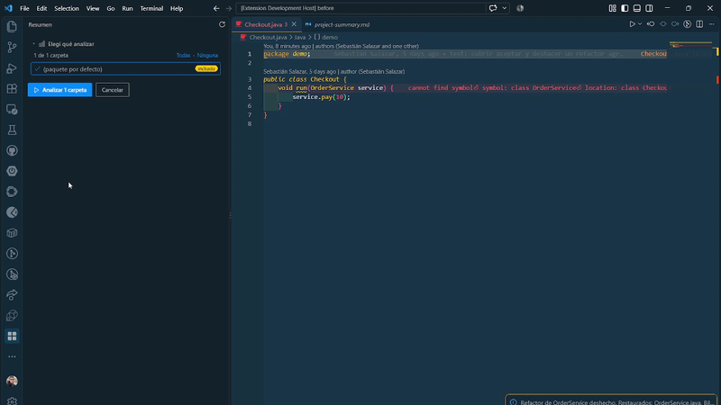
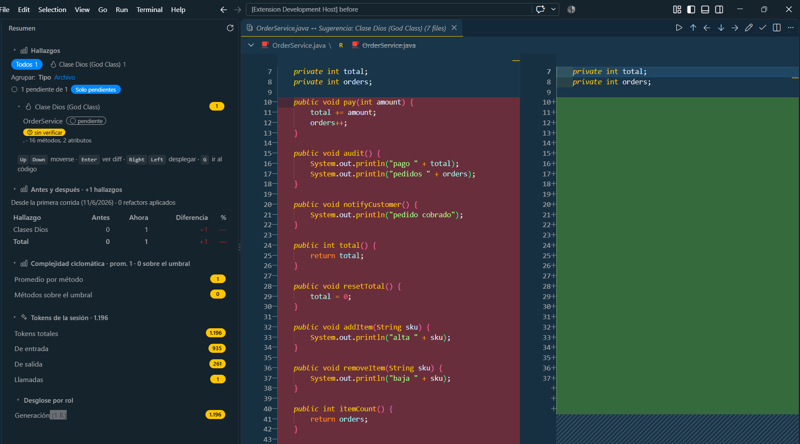
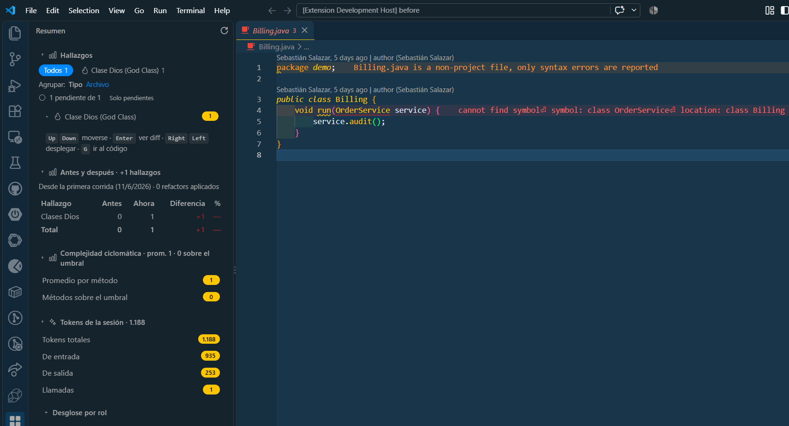
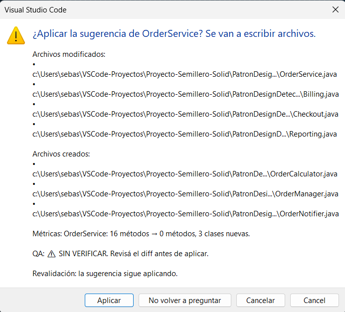
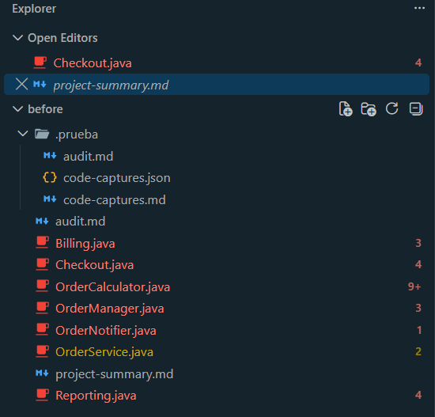
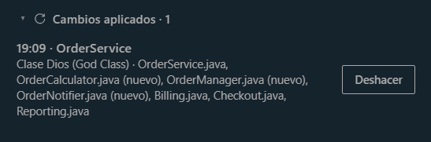
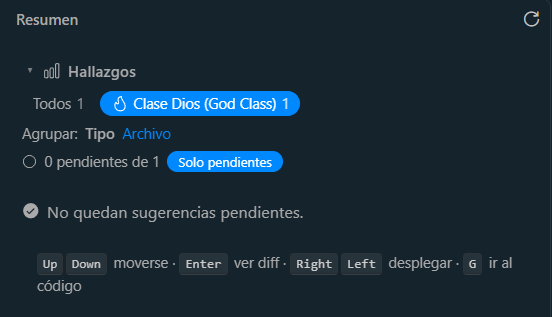

# Revisar y aceptar una sugerencia

Pattern Detector no modifica el proyecto por su cuenta: detecta hallazgos y,
cuando tiene evidencia suficiente, arma una **sugerencia de refactor**. La
revisión es supervisada: el diff muestra el contenido exacto que se escribiría
y nada se guarda hasta que aceptás. Todo lo aplicado se puede deshacer.

## Antes de empezar

- Proyecto Java abierto y backend configurado.
- Corré **Analizar proyecto** (`Ctrl+Shift+Alt+T`) o **Analizar cambios**
  (`Ctrl+Shift+Alt+M`) y abrí el panel **Resumen** (`Ctrl+Shift+Alt+R`).
- Las filas con sugerencia abren un diff; las que solo reportan un hallazgo
  muestran su ubicación.
- Si una clase dispara varios antipatrones a la vez, el panel muestra una
  **tarjeta de conflicto**: la IA recomienda cuál atacar primero y la elección
  es tuya. La sugerencia se genera después de elegir.

## 1. Abrir la sugerencia

Desde la fila del panel (con `Enter`) o con el QuickFix **Ver sugerencia de
refactor** del editor. Se abre la pestaña `<Archivo>.java ↔ Sugerencia: <tipo>`
con:

- la descripción de la propuesta;
- las clases que se extraerían, si las hay;
- el estado del QA: verificado, sin verificar o sin información (backend
  anterior a la verificación).

Nada de esto escribe archivos.

## 2. Leer el diff

El diff compara, a la izquierda, el archivo como está hoy y, a la derecha, la
propuesta. El lado derecho es de solo lectura: los cambios se escriben recién
al aceptar.

Si la sugerencia no trae un reemplazo completo, el código se agrega al final del
archivo; el modal de confirmación lo aclara con "(se agrega la sugerencia al
final)".

En un cambio agrupado, la pestaña no muestra un solo archivo sino una lista:
el original, las clases extraídas y los archivos que las usan. Se explica más
abajo.

## 3. Los botones del diff

| Botón | Qué hace | Atajo |
| --- | --- | --- |
| **Sugerencia anterior** | Cierra la actual y abre la pendiente anterior, en el orden de la lista del panel. | `Ctrl+Shift+Alt+P` |
| **Siguiente sugerencia** | Igual que la anterior, hacia adelante. | `Ctrl+Shift+Alt+N` |
| **Ajustar sugerencia** | Pide una instrucción en texto libre y regenera la propuesta. | `Ctrl+Shift+Alt+J` |
| **Aceptar cambios sugeridos** | Revalida, confirma y escribe los archivos. | `Ctrl+Shift+Alt+S` |
| **Descartar sugerencia** | Cierra el diff sin escribir nada. | `Ctrl+Shift+Alt+D` |
| **Elegir clases extraídas** | Elige qué clases de la propuesta se aplican. | `Ctrl+Shift+Alt+E` |
| **Ver implementación** | Genera y publica un documento técnico de la sugerencia. | `Ctrl+Shift+Alt+V` |

- **Siguiente** y **Anterior** recorren solo pendientes y no dan la vuelta: en
  un extremo avisan. Mientras el diff está activo, la barra de estado muestra
  `2 de 5 pendientes — <tipo> en <Clase>`.
- **Ajustar** no toca el disco: el backend regenera la propuesta con tu
  instrucción y se reemplazan el diff (simple o agrupado) y la fila del panel.
  Si cancelás el campo no se llama al backend; si el backend falla, la
  propuesta anterior queda intacta.
- **Descartar** cierra el diff sin escribir. La sugerencia queda marcada como
  descartada y después se pregunta si resultó útil. Si el diff es agrupado,
  cierra el grupo completo.
- **Elegir clases** abre un selector con cada clase extraída, su
  responsabilidad y los métodos que se mueven. Todo llega marcado salvo lo que
  ya habías desmarcado; cancelar no cambia nada. El diff y el panel se
  actualizan sin escribir archivos. Una selección vacía es válida: **Aceptar**
  avisa que no hay clases y no aplica nada. Si la sugerencia no extrae clases,
  avisa que no hay nada que elegir.
- **Ver implementación** solo aparece en el diff simple, no en el agrupado. La
  primera vez pide permiso para publicar el documento técnico (incluye
  fragmentos de la clase y el código propuesto) y abre un link de solo lectura
  que vence a los 30 días. La respuesta queda guardada en
  `prueba.publishExplanations`.

## 4. Aceptar: qué pasa antes de escribir

1. **Revalidación.** La sugerencia se revisa contra el texto actual del archivo
   y de los dependientes. Si algo cambió desde el análisis, no se aplica: el
   aviso explica el motivo y ofrece **Regenerar** con un análisis nuevo.
2. **Confirmación.** El modal lista archivos modificados, archivos creados,
   dependientes que quedan para cambiar a mano, colisiones detectadas, métricas
   antes/después, estado del QA y el resultado de la revalidación.
   - **Aplicar**: escribe.
   - **No volver a preguntar**: salta el modal hasta recargar la ventana; la
     revalidación se sigue haciendo siempre.
   - **Cancelar**: no escribe nada y el diff queda abierto.
3. **Colisiones.** Si una clase extraída choca con un archivo existente, se
   pregunta por cada una: **Reemplazar**, **Crear con sufijo** u **Omitir
   clase**. Cerrar el diálogo también omite la clase.
4. **Escritura.** El original, las clases extraídas y los dependientes se
   escriben en una sola operación. Si un paso falla, se deshacen los anteriores:
   no queda el archivo original cambiado con las clases a medio crear.
5. **Después.** Se cierra el diff, la sugerencia queda aplicada, aparece el
   aviso con **Deshacer**, se revisan errores de compilación nuevos y se
   pregunta si la sugerencia fue útil.

## 5. Cambios agrupados

El diff agrupado aparece cuando la sugerencia mueve métodos a clases nuevas y
otros archivos del proyecto llaman a esos métodos. En vez de abrir un diff por
archivo, VS Code abre un solo editor multi-diff con la lista completa:

- el **archivo original**, con el reemplazo propuesto;
- cada **clase extraída**, como archivo nuevo;
- cada **dependiente** que se puede reescribir, con las llamadas actualizadas.

El grupo se revisa junto y se acepta o se descarta entero:

- **Aceptar cambios sugeridos** aplica todos los archivos del grupo en una sola
  operación. Si una escritura falla, se deshacen los pasos anteriores.
- **Descartar sugerencia** cierra el grupo completo sin escribir nada.
- No hay un botón para aceptar solo un archivo del grupo.

La única forma de dejar algo afuera es **Elegir clases extraídas** antes de
aceptar: al desmarcar una clase no se crea su archivo y sus llamadas vuelven a
la forma original en los dependientes. Los argumentos de las llamadas no se
tocan.

Casos que conviene mirar en el modal:

- **Quedan para cambiar a mano**: el backend no pudo resolver la llamada de ese
  dependiente. No entra al diff; el proyecto no compila hasta actualizarlo.
- **Dependientes modificados desde el análisis**: **Aceptar** se bloquea y pide
  volver a analizar, porque el parche se calculó sobre un texto que ya no está.
- **Colisiones**: se resuelven por clase al aplicar, igual que en un diff
  simple.

## 6. Deshacer

Un refactor aplicado se deshace de tres maneras:

- el botón **Deshacer** del aviso que aparece al aceptar;
- el comando **Pattern Detector: Deshacer último refactor aplicado** de la
  paleta;
- el botón **Deshacer** de cada entrada del bloque **Cambios aplicados** del
  panel Resumen.

Deshacer restaura todos los archivos que tocó el refactor, en orden inverso, y
borra los archivos que creó. En un cambio agrupado revierte el grupo completo:
original, clases extraídas y dependientes. La sugerencia vuelve a quedar
pendiente en el panel.

El bloque **Cambios aplicados** lista los refactors aceptados del más nuevo al
más viejo, con hora, clase, tipo y archivos tocados. El historial sobrevive a
recargar la ventana.

Si un archivo cambió después de aplicar:

- el último refactor pide confirmación con **Deshacer igual** y avisa que esos
  cambios se pierden;
- un refactor anterior no se deshace automáticamente: el panel muestra "No se
  puede deshacer automáticamente" y hay que deshacer primero los posteriores o
  revertir esos cambios a mano.

Después de aceptar, si hay una extensión de Java instalada, se comparan los
errores de compilación de antes y después. Si aparecieron errores nuevos, se
listan con archivo y línea y se ofrece **Revertir** (lo mismo que deshacer) o
**Mantener igual**. La lista completa queda en el canal de salida Pattern
Detector. Sin soporte de Java, la extensión avisa una vez por sesión que no
puede verificarlo.

## 7. Terminar el recorrido

Al aceptar o descartar, por defecto se abre sola la siguiente pendiente. Se
puede desactivar con el setting `prueba.review.autoAdvance` en `false`; en ese
caso el diff se cierra y te quedás donde estabas.

Cancelar la confirmación, fallar al aplicar o cerrar el diff a mano no registra
la revisión, así que no avanza.

Cuando ya no quedan pendientes hacia adelante, aparece el resumen de la sesión:
cuántas se aplicaron, se descartaron y se ajustaron. Desde ahí se puede:

- **Retomar pendientes**, si quedaron sugerencias sin revisar;
- **Ver cambios aplicados**, si se aplicó al menos una;
- **Volver a analizar**, para generar un análisis nuevo.

El panel marca cada sugerencia revisada y el filtro **Solo pendientes** oculta
las que ya viste.

Los atajos del diff funcionan con el foco en la pestaña de la sugerencia; el
tooltip de cada botón muestra el atajo.