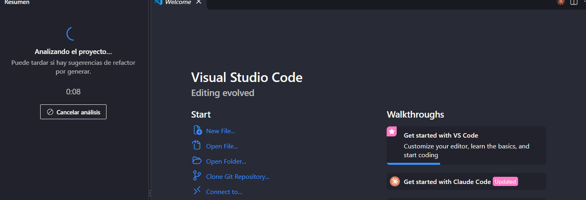
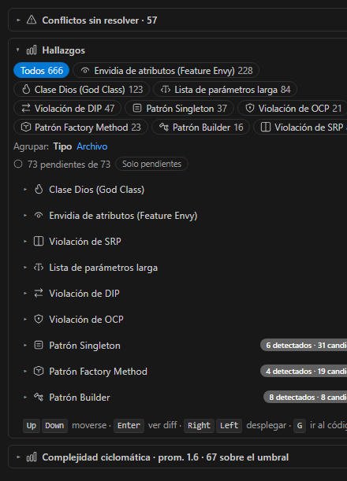
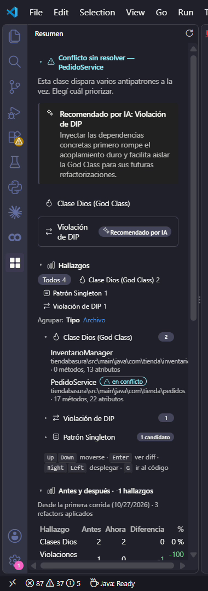
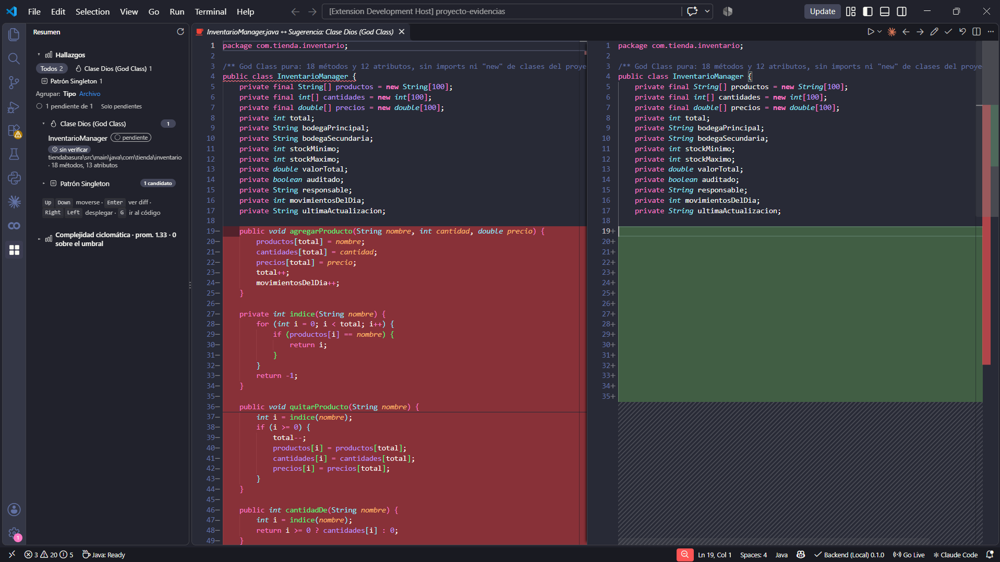
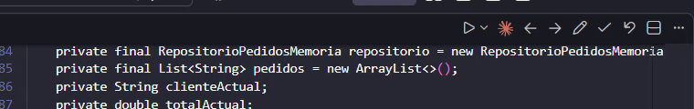
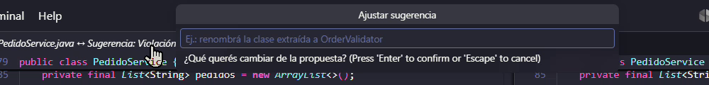
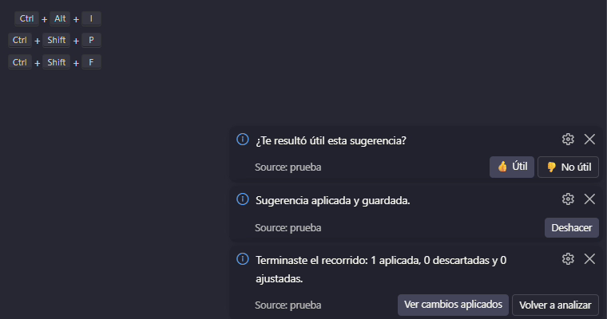
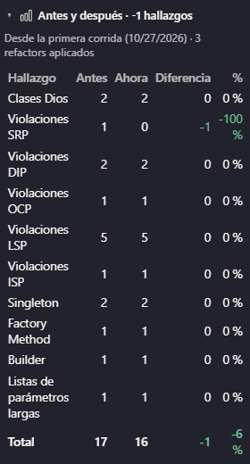

# Uso de la extensión

Todo se maneja desde el **panel Resumen**: se analiza el proyecto, se revisan los hallazgos y se recorren las sugerencias de refactor sin salir del diff. Esta página sigue ese recorrido de principio a fin.

## Antes de empezar

La extensión le manda el código al backend, así que necesita saber dónde está:

| Ajuste | Para qué sirve |
|---|---|
| `prueba.backendUrl` | URL del backend. Por defecto, uno local en `http://localhost:8000`. |
| `prueba.backendApiKey` | La clave que pide el backend desplegado. Con un backend local sin clave, se deja vacía. |
| `prueba.backendTimeoutMs` | Cuánto se espera el análisis antes de cortar. Por defecto, 5 minutos. |

Para pasar del backend local al de producción sin tocar los ajustes a mano está el comando **Cambiar perfil de backend (Local/Producción)**. El backend de producción corre en un plan gratuito que se duerme si nadie lo usa, así que el primer análisis del día puede tardar un minuto más.

## 1. Analizar el proyecto

Abrí el panel **Resumen**, desde su ícono en la barra lateral o con el comando **Abrir panel Resumen**, y usá **Analizar proyecto**. La extensión junta los `.java` del workspace, ignora carpetas como `target/`, `build/` o `node_modules/`, y se los manda al backend.

Mientras analiza, el panel muestra el progreso y un botón para cancelar:

**Analizar cambios** vuelve a analizar solo los archivos que cambiaron desde el último análisis. Es más rápido cuando se está refactorizando.

## 2. Leer el panel

Cuando termina el análisis, el panel se arma en bloques:

- **Conflictos sin resolver**: clases que tienen dos o más antipatrones a la vez. Ver el paso 3.
- **Hallazgos**: la lista principal.
- **Antes y después**: cuánto cambió cada tipo de hallazgo desde el primer análisis del proyecto.
- **Cambios aplicados**: los refactors aceptados en la sesión, cada uno con su botón **Deshacer**.
- **Complejidad ciclomática** y **Tokens de la sesión**: las métricas del código y lo que se gastó de IA.

En **Hallazgos** hay tres controles:

- Arriba, un **filtro por tipo**, con el total de cada tipo.
- **Agrupar** por tipo o por archivo.
- **Solo pendientes**, que esconde lo que ya se aplicó o se descartó.

Cada fila tiene un link para ir a la clase en el código. Las que tienen una sugerencia de refactor abren su diff al hacer clic.

En los patrones creacionales (Singleton, Factory Method, Builder) el panel separa los **detectados**, que ya están implementados, de los **candidatos**, donde el patrón encajaría. La sugerencia de un candidato se genera recién cuando se pide con **Generar sugerencia**, para no gastar IA en lo que no se va a mirar.

La lista se puede recorrer con el teclado. Las teclas aparecen al pie del bloque: flechas para moverse, `Enter` para abrir el diff y `G` para ir al código.

## 3. Resolver un conflicto

Cuando una clase dispara varios antipatrones a la vez (por ejemplo, Clase Dios y Violación de DIP), no se genera una sugerencia para cada uno, porque se pisarían entre sí. El panel muestra una tarjeta con la **recomendación de la IA** sobre cuál atacar primero y por qué. Vos elegís cuál y recién ahí se genera la sugerencia de ese.

Si hay muchos conflictos, el panel los agrupa en una sección plegada, para que la lista de hallazgos siga a la vista.

## 4. Revisar una sugerencia en el diff

Una sugerencia se abre como un **diff**: a la izquierda el archivo actual y a la derecha cómo quedaría.

Cuando la sugerencia extrae clases (Clase Dios, SRP) y otros archivos del proyecto llaman a los métodos que se mueven, se abre un **diff agrupado**: el original, cada clase nueva y cada archivo que la usa, con la llamada ya corregida. Si una llamada no se puede corregir sin riesgo, ese archivo queda marcado para cambiarlo a mano.

Las acciones están en la barra del diff, siempre en el mismo orden:

| Acción | Qué hace |
|---|---|
| **Anterior / Siguiente** | Recorre las sugerencias pendientes en el orden del panel. |
| **Ajustar** | Pide un cambio con tus palabras ("no muevas `validar`") y la IA regenera la sugerencia. |
| **Aceptar** | Aplica la sugerencia. |
| **Descartar** | La marca como descartada y pasa a la siguiente. |
| **Elegir clases** | En una extracción, deja aplicar solo algunas de las clases nuevas. |
| **Ver implementación** | Abre en el navegador el documento técnico del refactor (ver abajo). |

### Aceptar

Antes de escribir nada, la extensión vuelve a comprobar la sugerencia contra el archivo como está ahora. Si cambió desde el análisis, no la aplica, porque pisaría lo que escribiste. Si sigue valiendo, muestra un resumen con los archivos que va a modificar y crear, las métricas antes y después y si la sugerencia pasó la verificación de la IA. Recién con tu confirmación escribe.

Después de aplicar:

- El aviso trae **Deshacer**, que deja el proyecto exactamente como estaba.
- Si tenés una extensión de Java instalada, se revisa si el refactor dejó errores de compilación nuevos. Si los dejó, se listan con archivo y línea y se ofrece revertir.

### Ver implementación

**Ver implementación** publica un documento técnico de la sugerencia y lo abre en el navegador. El documento explica qué principio se incumplía, con la evidencia del detector, por qué se eligió esa solución, qué alternativas se descartaron, los riesgos y el código antes y después. El link se puede compartir y vence a los 30 días.

Como el documento lleva fragmentos del código, la primera vez la extensión pregunta si se puede publicar. Se puede cambiar después con el ajuste `prueba.publishExplanations` (`ask`, `allow` o `deny`).

Qué datos se publican, quién los puede ver y cómo se borran: [Ver implementación](ver-implementacion).

## 5. El recorrido: de sugerencia en sugerencia

Con muchas sugerencias, la idea es no volver al panel después de cada una:

- **Siguiente** y **Anterior** pasan solo por las **pendientes** y se saltean las que ya se aplicaron o se descartaron. La barra de estado muestra la posición, por ejemplo "2 de 5 pendientes".
- Al **Aceptar** o **Descartar**, se abre sola la siguiente pendiente. Se apaga con `prueba.review.autoAdvance`.
- Al terminar, un aviso resume la sesión (cuántas se aplicaron, se descartaron o se ajustaron) y ofrece ver los cambios aplicados o volver a analizar. Si quedaron pendientes salteadas, ofrece retomarlas.

## 6. Ver la mejora

Después de aplicar refactors, **Analizar proyecto** de nuevo. El bloque **Antes y después** compara contra el primer análisis del proyecto: por cada tipo de hallazgo, cuántos había, cuántos hay y la diferencia, con las bajas en verde.

Todo esto queda también en `project-summary.md`, en la raíz del proyecto: los hallazgos por archivo, la comparación con el análisis anterior, el antes y después, los cambios aplicados y el resumen de la revisión.

## Atajos de teclado

Todos los comandos de uso frecuente tienen un atajo con `Ctrl+Shift+Alt` (`Cmd+Shift+Alt` en macOS) más una tecla, y están en la paleta bajo **Pattern Detector**. La tabla completa está en la sección [Atajos de teclado del README de la extensión](https://github.com/SemilleroSOLID/PatronDesignDetector#atajos-de-teclado) (repositorio del equipo). Desde VS Code también se ven en **Preferencias: Abrir métodos abreviados de teclado**, buscando "Pattern Detector".
