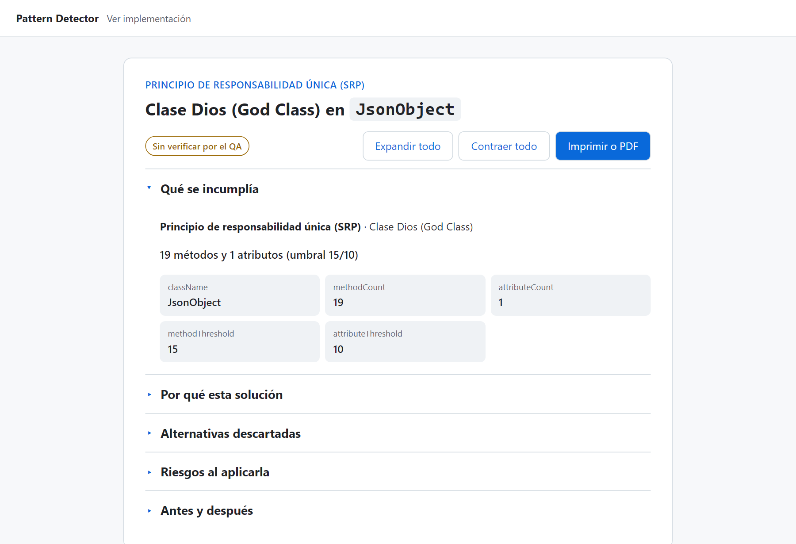
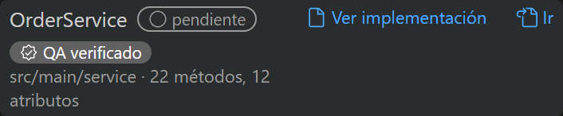
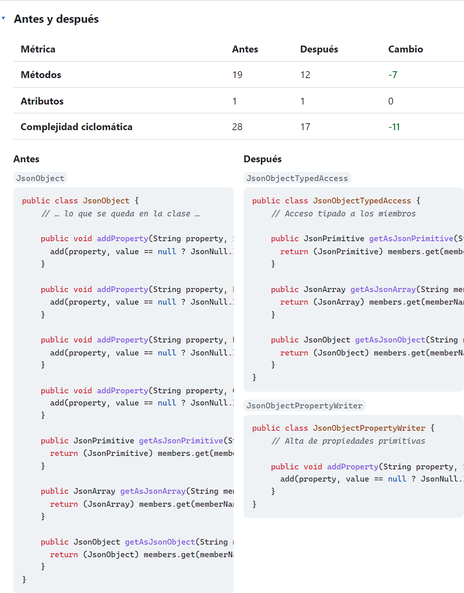

# Ver implementación

**Ver implementación** convierte una sugerencia de refactor en un **documento técnico** que se abre en el navegador. Sirve para entender el refactor antes de aplicarlo, para mostrárselo a otra persona del equipo o para guardarlo en PDF.

## Qué explica el documento

| Sección | Qué trae |
|---|---|
| **Qué se incumplía** | El principio y el antipatrón, con la evidencia del detector: los números que lo dispararon y el umbral. |
| **Por qué esta solución** | El problema concreto en esa clase y por qué se eligió esta solución. |
| **Alternativas descartadas** | Otras formas de resolverlo y por qué no se eligieron. |
| **Riesgos al aplicarla** | Lo que conviene revisar antes de aceptar. |
| **Antes y después** | Métodos, atributos y complejidad ciclomática antes y después, y el código lado a lado. |

Arriba se ve si la sugerencia pasó la verificación de la IA, y hay botones para expandir o contraer todo y para **Imprimir o PDF**.

La evidencia, las métricas y el código salen del análisis, sin IA. El texto de **Por qué esta solución**, **Alternativas** y **Riesgos** lo escribe la IA. Si la IA no responde, esas secciones lo avisan y el resto del documento se muestra igual.

## Cómo abrirlo

Desde cualquiera de estos dos lugares:

- **El diff de la sugerencia:** el botón **Ver implementación**, al final de la barra de acciones.
- **El panel Resumen:** el link **Ver implementación** en la fila del hallazgo. Aparece al pasar el mouse en las filas que tienen sugerencia.

Mientras se arma el documento, VS Code muestra "Generando documento…". Cuando termina, se abre en el navegador. Si volvés a pedir la misma sugerencia en la misma sesión, se abre el mismo link al instante. Una sugerencia que [ajustaste](uso-extension#4-revisar-una-sugerencia-en-el-diff) genera un documento nuevo.

Armar el documento usa la IA una vez. Esos tokens se suman al bloque **Tokens de la sesión** del panel, en la fila **Explicación**.

## Antes de publicar: el permiso

El documento se publica en una página web, y **lleva fragmentos de tu código**. Por eso, la primera vez la extensión pregunta si puede publicarlo, y guarda tu respuesta en el ajuste `prueba.publishExplanations`:

| Valor | Qué pasa |
|---|---|
| `ask` (por defecto) | Pregunta la primera vez y guarda la respuesta. |
| `allow` | Publica sin preguntar. |
| `deny` | **No publica nada**: no se envía nada al backend, ni siquiera para armar el documento. |

Si cerrás la pregunta sin elegir, no se publica y la próxima vez vuelve a preguntar. Con `deny`, el aviso ofrece abrir el ajuste para cambiarlo.

## Qué datos se publican

Solo lo necesario para explicar el refactor:

| Se publica | No se publica |
|---|---|
| El nombre de la clase, el antipatrón y el principio | El archivo completo |
| La evidencia del detector (cantidades, umbrales, nombres de métodos) | La ruta del archivo ni el nombre del proyecto |
| Las métricas y la complejidad antes y después | Quién lo publicó |
| **Código "antes": solo los métodos que se mueven** | Los campos y los métodos que se quedan en la clase |
| **Código "después": las clases nuevas o el fragmento sugerido** | |
| El texto de la IA y si pasó la verificación | |

En el código "antes", lo que se queda en la clase se reemplaza por un marcador (`// … lo que se queda en la clase …`):

Para armar el documento, la extensión manda el archivo al backend, igual que cuando analiza el proyecto. El backend usa la IA para escribir la explicación y **guarda solo el documento**, nunca el archivo.

## Quién lo puede ver y cuánto dura

- **Cualquiera que tenga el link.** El link es lo único que da acceso: no hay un listado de documentos ni un buscador, y el identificador del link es aleatorio y no se puede adivinar. Si lo pasás por un chat, quien lo reciba lo puede abrir.
- **Vence a los 30 días.** Después, el link muestra "no existe o ya venció", lo mismo que un link que nunca existió.
- **Se borra solo al vencer.** Hoy no hay un botón para borrarlo antes. Si publicaste algo por error, pedile a quien administra el backend que lo borre.

## Dónde vive

La página es una app web aparte, publicada en GitHub Pages: [PattronDesingDetector-Implementaciones](https://github.com/SemilleroSOLID/PattronDesingDetector-Implementaciones). Lee el documento del backend y, mientras el backend gratuito despierta, avisa que puede tardar un minuto y reintenta.

La decisión de publicarlo así (por qué una app aparte, qué datos se guardan, cuánto duran y cómo se borran) está en el ADR 0002 del backend, en `docs/adr/`. El contrato de los endpoints que lo publican y lo leen (`POST /explanations` y `GET /explanations/{id}`) está en el [Contrato de API](/api-contrato/).
